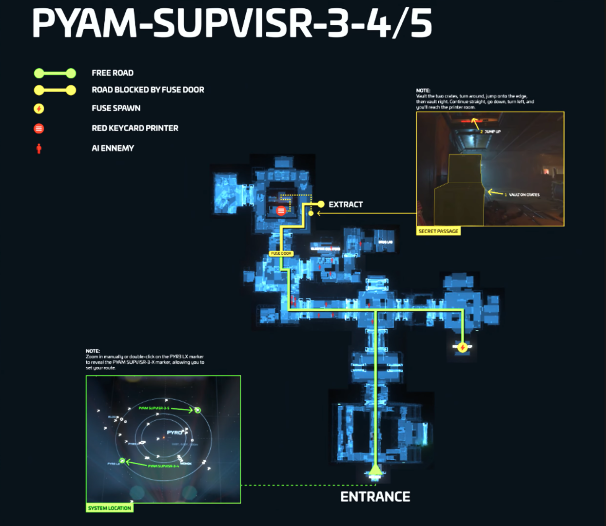
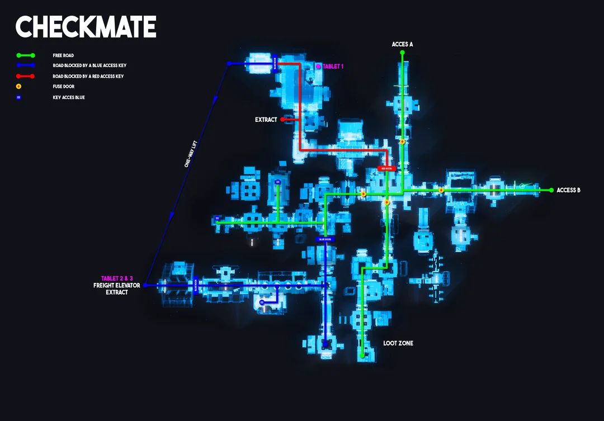
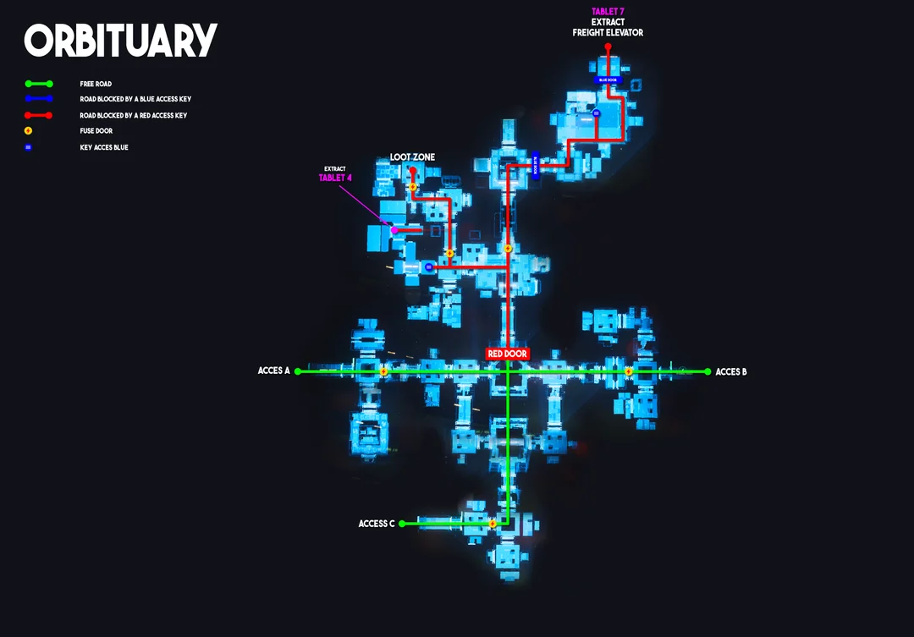
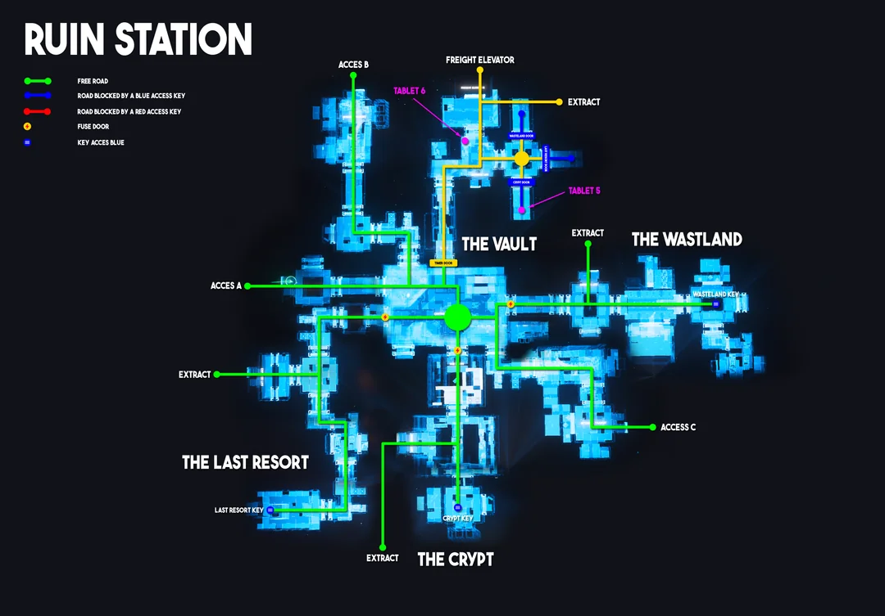

> 🌌Sistema Pyro
> 🪐Localización: Chekmate, Orbituary y Ruin Station

## Antes de empezar
- Armadura pesada y oscura
- Rifle de asalto, francotirador, granadas
- Munición abundante
- MedPens / equipo médico
- Fusibles

## Pasos
1. Ir a por varias tarjetas rojas a los puestos de PYAM-SUPVISR 3-4/5
2. Ir a cualquiera de las estaciones principales de Chekmante, Orbituary o Ruin Station
3. Ir a la zona de las tarjetas
4. Habrá que acabar con los Jugadores y NPC que haya
5. En algunas estaciones habrá que coger tarjetas azules también, esas spawnean en las zonas de combate
6. Todas las tarjetas cuando se sacan tardan en respawnear entre 30-40 minutos
7. Conseguir las tarjetas y salir vivos

## Consejos
> Si se consigue llegar a la zona de las tarjetas, esperar ese tiempo de respawn y sacar varias tarjetas
> Limpiar todas las esquinas por si hay algún campero

