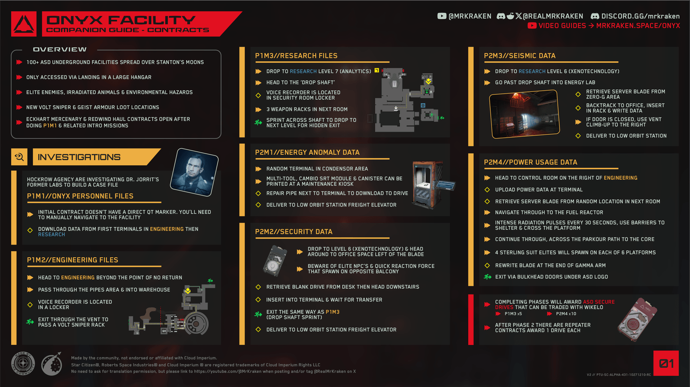
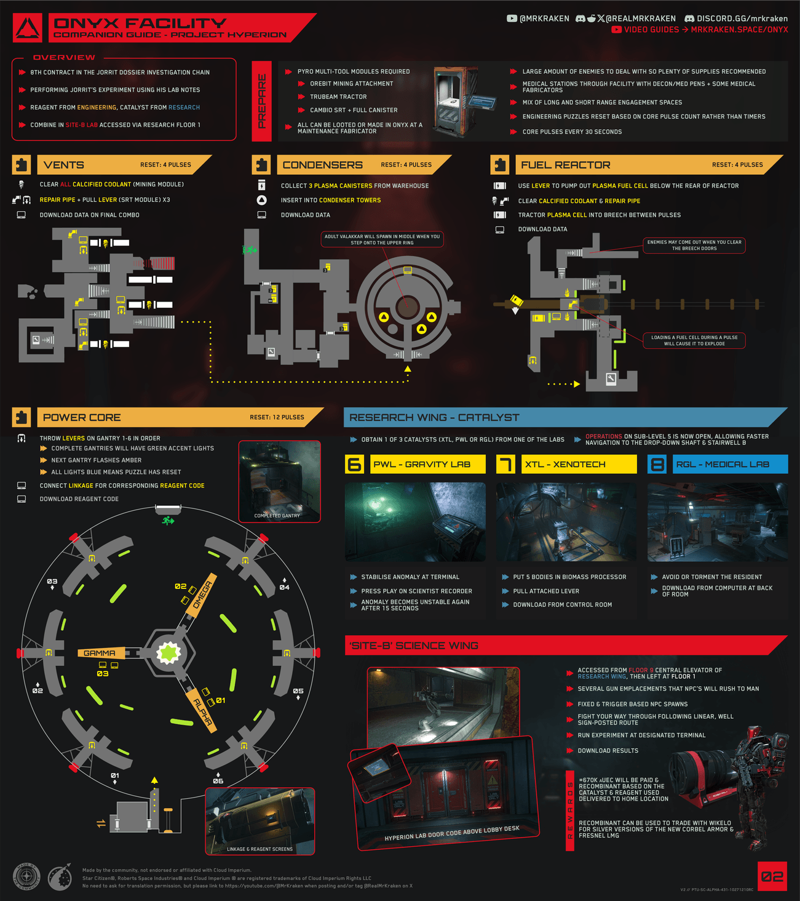
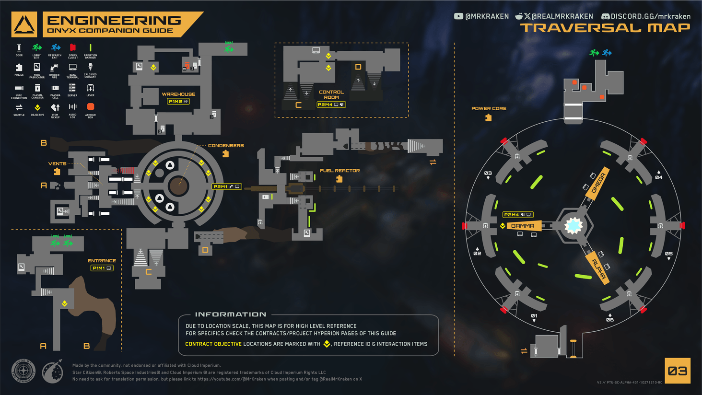
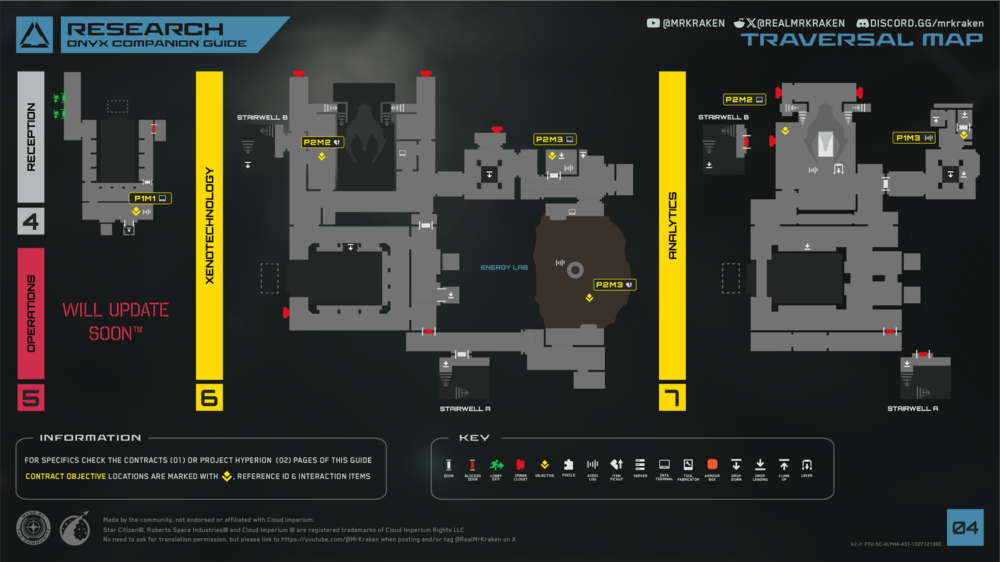
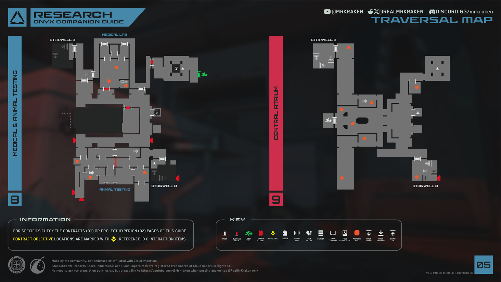

> 🌌Sistema Stanton
> 🪐Localización: ASD Onyx Facility

## Antes de empezar
- Armadura y armamento FPS
- Arma principal y secundaria
- Munición abundante
- MedPens / equipo médico
- Multi-Tool pequeña con tractor beam
- Multi-Tool con atachment de minar y de arreglar
- Mochila con espacio disponible
- Nave de combate o transporte con capacidad para toda la escuadra

## Pasos
1. Ir completando las misiones hasta tener la última
2. Minar las ventilaciones y arreglar los conductos
3. Descargar los datos de la terminal
4. Colocar las 3 baterias en el circulo principal (Aparecera un valakkar grande que habrá que matar)
5. Descarga los datos de la consola
6. Ir a la sala de control y limpiar mientras se avanza
7. LLegar al reactor de potencia
8. En el reactor de potencia habra a la izquierda una palaca que habrá que bajarla para que aparezca la celula de bateria de plasma
9. Romper las estalacmitas que cubren la compuerta donde deberá ingresar la celula de bateria (se deberá minar los los lados)
10. Arreglar el conducto en la parte superior
11. Ingresar la celula de bateria y esperar a que el nucleo haga la explosión
12. Descargar los datos de la terminal
13. Avanzar haciendo parkour y tomando un metro hasta la zona del nucleo de potencia
14. Acabar con todos los NPC de las plataformas **(cubirse de las explosiones del nucleo que emiten radiación, son cada 30seg)**
15. Activar las palancas de las plataformas en orden del 1 al 6
16. Activar cualquiera de los 3 codigos, para ello, habrá que acercarse a cualquiera de ellos y en una pantalla antes de llegar habrá que darle para que se conecte y luego ir a la del codigo y descargar los datos
17. Ir a la salida del nucleo, puerta que ponga ASD en la pared
18. Obtener 1 de los 3 catalizadores, estos se encuentran en la sala de *RESEARCH*. **Abajo del todo se explica donde están los catalizadores**
20. Bajar hasta el ascensor princial del patio central en la planta 9
21. Sube a la planta 1
22. Gira a la izquierda y baja por el agujero
23. Avanza hasta llegar al ascensor que te llevara al SITE-B
24. Avanza acabando con los NPC hasta llegar al proximo ascensor
25. Acabar con los NPC y llegar a la pasarela en la cual habrá NPC
26. Avanzar por la pasarela y al llegar al final dirigirse a la derecha acabando con los NPC que haya
27. Luego giraremos a la izquierda y seguiremos avanzando acabando los todos los NPC que haya hasta llegar a una sala con un mostrador
28. Ahí habra que matar a los NPC y conseguir el código de la puerta que se encuentra en la parte superior del interior del mostrador
29. Ingresar el código en la puerta roja y avanzar matando a los NPC
30. Llegar a la puerta de la anticamara
31. En la puerta grande que habrá al fondo de la sala, cuando se abrá por proximidad, apareceran unos NPC que habrá que matar
32. Avanzar hasta llegar al laboratorio y subir a la planta de arriba para activar el terminal y proceder con el experimento
33. Descarga los resultados (estos se enviarán a tu base principal)
34. Extraer

- CATALIZADOR 1 XTL:

Bajar al piso inferior el introducir 5 cuerpos al modulo de biomasa en la planta 7
Bajar la palanca e ir a al ordenador para descargar los datos en la planta 6

- CATALIZADOR 2 XTL:

Bajar al laboratorio de gravedad en la planta 6
Estabilizar la anomalia y recoger los datos del cientifico

- CATALIZADOR 3 RGL:

Bajar al laboratorio medico en la planta 8
Descargar los datos del ordenador
Acabar con el tio Sam

## Consejos
> Cubrirse bien de la radiación en el núcleo de energía
> Cada catalizador está vinculado a un objeto de wikello

